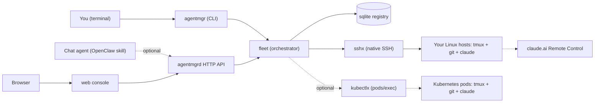

# agent-manager

A small fleet manager for remote coding-agent sessions. It holds an SSH
private key, reaches a list of Linux hosts (or Kubernetes pods), launches
`claude` inside `tmux` in a git worktree, **captures the Remote Control URL**,
and keeps a sqlite registry of what is running where. It also does plain git
refreshes (fetch / ff-only / rebase / merge) on those same checkouts. It is for
one person or a small team running Claude Code on machines other than the one
in front of them.

> **Note:** this repository is an automated export of another, private
> repository. It documents local installation only — there are no
> production/deployment instructions here. Some details (internal docs,
> deployment, operational notes, the live-verification log, the original
> research notes referred to as `need.md`) were deliberately left out, so parts
> may be missing or under-explained; issues pointing them out are welcome.
> Host and repository names in the docs and tests (`devbox`, `homelab`,
> `laptop-a`, `api-kit`, `notes-svc`, …) are fictional.

```
TASK          RUNNER       HOST      REPO        BRANCH              STATE    AGE  URL
fix-rounding  claude-code  laptop-a  shop-agent  agent/fix-rounding  running  4m   https://claude.ai/code/session_01FX…
probe-docs    claude-code  laptop-b  cli-kit     agent/probe-docs    running  6m   https://claude.ai/code/session_01PA…
```

**Why this exists**: there is no published API that enumerates Claude Code
Remote Control sessions with their URLs. The only reliable moment to learn a
session's URL is when it is printed, at launch — so the launcher has to be the
thing that records it. Everything else here follows from that.

Three surfaces over one core package (`fleet`): a **CLI**, an **HTTP API**, and
a **web console**.

## Topology



The CLI and the API both drive the same `fleet` package, which reaches each
host through one `Transport` (SSH by default, Kubernetes `pods/exec`
optionally), and records every session in a local sqlite file. The agents
themselves talk to Anthropic's Remote Control service; agent-manager only
records the URL they print.

## Prerequisites

- Go 1.25+ (`go.mod`), `make`.
- On each **remote** host: Linux, `tmux`, `git`, and an already-authenticated
  `claude` on PATH. Nothing is installed there by agent-manager.
- An SSH key you dedicate to this tool, authorized on those hosts.
- Optional: a Kubernetes cluster and a kubeconfig, for `transport: kubectl`
  hosts. Optional: `podman` or `docker` for `make image`.

## Installation

```bash
git clone https://github.com/aldrinleal/agent-manager-public.git
cd agent-manager-public
make cli                          # -> bin/agentmgr
make build                        # static linux/amd64 agentmgr + agentmgrd
```

## Local configuration

```bash
cp .env.example .env              # at minimum AGENTMGR_SSH_KEY_FILE
cp hosts.example.yaml hosts.yaml  # your hosts and their checkouts
```

The binaries read the environment, not `.env` directly — load it with
`set -a; . ./.env; set +a` (or direnv).

| Variable | Required | Purpose |
|---|---|---|
| `AGENTMGR_INVENTORY` | no | path to `hosts.yaml` (default `hosts.yaml`) |
| `AGENTMGR_DB_PATH` | no | sqlite registry (default `agentmgr.db`) |
| `AGENTMGR_API_TOKEN` | **yes, for `agentmgrd`** | bearer token; the server refuses to start without one |
| `AGENTMGR_SSH_KEY_FILE` | yes (or `AGENTMGR_SSH_KEY`, or an agent) | the dedicated private key |
| `AGENTMGR_KNOWN_HOSTS` | no | host keys, strictly verified (default `~/.ssh/known_hosts`) |
| `AGENTMGR_KUBECONFIG` | no | only for `transport: kubectl` hosts |

`.env.example` documents every other knob (timeouts, reconcile interval,
history collection, privacy switch for stored prompts).

## Running

```bash
bin/agentmgr hosts trust devbox   # shows the fingerprint, then pins it
bin/agentmgr check                # linux? tmux? git? claude?

bin/agentmgr up devbox/my-repo fix-tax \
  --prompt="Reproduce the tax rounding bug with a test, then fix it."
# -> https://claude.ai/code/session_...

bin/agentmgr ls
bin/agentmgr log fix-tax
bin/agentmgr send fix-tax "also run the linter"
bin/agentmgr kill fix-tax         # the worktree is kept
```

The server (API + console on `:8000`):

```bash
export AGENTMGR_API_TOKEN=$(openssl rand -base64 32)
make serve                        # then open http://localhost:8000/
```

## Inventory

A host is a **connection method** plus an **allowlist of paths**:

```yaml
defaults:
  identity: ~/.ssh/id_agentmgr
  worktree_root: /srv/agent-workspaces
  log_root: /srv/agent-logs

hosts:
  # "username@host is enough"
  - name: devbox
    address: dev@devbox
    paths:
      - name: my-repo
        dir: /home/dev/code/my-repo
        branch: main

  # reached only through a bastion, on a non-default port —
  # i.e. `ssh -J ubuntu@bastion.example.net -p 2200 dev@localhost`
  - name: homelab
    address: dev@localhost:2200
    jump: bastion
    env:
      # `claude` is a ~/.local/bin install and a non-interactive shell reads
      # no rc file. Without this the launch exits 127.
      PATH: /home/dev/.local/bin:/usr/bin:/bin
    paths:
      - name: notes-svc
        dir: /home/dev/src/notes-svc

  - name: bastion
    address: ubuntu@bastion.example.net
    role: jump          # tunnelled through, never launched on
```

`address` + `jump` is the whole connection model, and it maps 1:1 onto how
`x/crypto/ssh` chains connections — no `~/.ssh/config` parsing, no `ssh`
binary. `role: observer` hosts are read from (their Claude history) but never
launched on; `scripts/observer/` restricts such a key to two commands.
`transport: kubectl` hosts are pods reached through `pods/exec` (`namespace`,
`pod`, optional `container`) — see `hosts.example.yaml` and SPEC §5.5.

**`paths` is a security boundary.** The API takes a path *name*, never a
filesystem path, so a directory not listed here cannot be launched into or
refreshed.

Per-path options: `remote` (`origin`), `branch` (`main`), `refresh`
(`ff-only` | `rebase` | `merge` | `fetch-only`), `workspace`
(`worktree` | `inplace`), `allow_dirty`.

## The key

Resolution order: `AGENTMGR_SSH_KEY` (PEM contents, never touches disk) → the
host's `identity:` → `AGENTMGR_SSH_KEY_FILE` → `$SSH_AUTH_SOCK`. Encrypted
keys use `AGENTMGR_SSH_KEY_PASSPHRASE`; the CLI may prompt, the server never
does and fails to start instead.

The parsed signer lives in memory for process lifetime. It is never logged,
never persisted, never returned by the API — `/hosts` reports only the SHA256
fingerprint.

Host keys are verified strictly against `known_hosts`. Onboard with
`agentmgr hosts trust <host>` (prints the fingerprint, asks, appends). To skip
verification: `--insecure-host-key`, or `AGENTMGR_SSH_INSECURE_HOST_KEY=true`
— it warns on every dial.

> **Use a dedicated key.** This process is, by construction, a remote-code-
> execution service for every host in the inventory. Generate
> `~/.ssh/id_agentmgr`, authorize it for a dedicated unix account on each
> host, and keep the API on your private network behind the bearer token.

## What a launch actually does

1. **Preflight** the host (cached 30 min): linux, tmux, git, `claude`.
2. **Worktree**: `git fetch --prune` then `git worktree add -B agent/<task>`
   from `<remote>/<branch>`. (`--inplace` runs in the checkout instead.)
3. **Prompt** → `<log_root>/<repo>/<task>.prompt.md`, written down the SSH
   session's raw stdin. It is never quoted, never shell-interpreted, and never
   passes through tmux's parser. It lives beside the log rather than in the
   worktree, so the checkout never goes dirty.
4. **Launch script** → `<log_root>/<repo>/<task>.launch.sh` (0700), which
   exports the host's `env:` and `exec`s
   `claude --remote-control <label> "$(cat …/<task>.prompt.md)"`.
5. **tmux**: `new-session -d` running that script, with `remain-on-exit on`
   chained into the same command so a fast-failing agent still leaves a
   readable, dead pane with a real exit status.
6. **pipe-pane** tees output to `<log_root>/<repo>/<task>.log`.
7. **URL scrape** polls the pane and the log for `https://claude.ai/code/…`.
   Not finding one is *not* a failure — the session stays usable.

Liveness is then reconciled independently of the URL, one round trip per host:
`tmux list-panes -a` plus one `stat` over every log file.

States: `starting` → `running` → (`stale` | `stopped` | `failed`).

## HTTP API

Bearer token on everything under `/api/fleet/v1`; `GET /healthz` and the
console are open.

| Method | Route | |
|---|---|---|
| `GET` | `/hosts` | inventory + preflight + key fingerprints |
| `POST` | `/hosts/{host}/check` | re-run preflight |
| `GET` | `/sessions` | `?host=&repo=&state=&active=&reconcile=` |
| `POST` | `/sessions` | launch → `202` |
| `GET` | `/sessions/{id}` | one session |
| `GET` | `/sessions/{id}/log?tail=200` | |
| `GET` | `/sessions/{id}/attach` | ssh + tmux commands |
| `POST` | `/sessions/{id}/send` | `{"text": "..."}` |
| `DELETE` | `/sessions/{id}?remove_worktree=` | |
| `POST` | `/refresh` | `{host, path?, strategy?, force?}` |

```bash
curl -s -H "Authorization: Bearer $AGENTMGR_API_TOKEN" \
  -d '{"host":"devbox","path":"my-repo","task_id":"fix-tax","prompt":"..."}' \
  localhost:8000/api/fleet/v1/sessions
```

An `{id}` may be a session id or an unambiguous task id. The full route list
(history, work log, auth, push) is in SPEC §12 and
`openclaw/agent-manager-fleet/references/api.md`.

## Git refresh

```bash
agentmgr refresh devbox                       # every path on the host
agentmgr refresh devbox/my-repo --strategy=rebase
```

Always `fetch` + an explicit merge/rebase against `<remote>/<branch>`, never
`git pull` — so it works on a detached or oddly-tracked checkout. Reports
before/after SHAs and a diffstat. A failed merge/rebase is left mid-operation
on purpose; `refresh` reports the conflicted paths and never runs `--abort`
for you.

Uncommitted changes to **tracked** files block a refresh (`--force` or
`allow_dirty` overrides). Untracked files do not.

Git credentials are the host's business. The manager's key authenticates *to*
the host; the host's own key authenticates to GitHub.

## OpenClaw skill

`openclaw/agent-manager-fleet/` wraps this API as an
OpenClaw skill, so a chat agent can
list the fleet, launch a session, tail or steer one, and refresh a checkout.
Needs `AGENTMGR_API_TOKEN`; `AGENTMGR_URL` defaults to `http://localhost:8000`.

```sh
scripts/fleet.sh                       # every session, with its URL
scripts/launch.sh laptop-a/shop-agent fix-tax "Reproduce the bug with a test, then fix it."
```

## Layout

```
cmd/agentmgr    CLI (docopt)          cmd/agentmgrd  server (gin)
config/         settings + inventory  sshx/          SSH: key, host keys, pool, exec
transport/      the Transport seam    kubectlx/      pods/exec transport (client-go)
tmux/           command building      gitx/          refresh + worktrees
runner/         Runner + claude-code  registry/      sqlite
history/        history.jsonl parsing fleet/         the orchestrator
api/            gin routes            console/       embedded page
```

Two invariants worth keeping:

1. **`transport.Transport` is the seam.** `sshx` and `kubectlx` implement it;
   nothing in `tmux/`, `gitx/`, `runner/` or `fleet/` imports either.
2. **The prompt never passes through a shell.** It is written as a file down
   the session's raw stdin and read with `"$(cat …)"` by the generated launch
   script; `runner.LaunchSpec` has no prompt field, and tests assert the
   prompt cannot appear in the script.

`SPEC.md` is the full design; §16 lists the gotchas worth not re-discovering
(most of them fail silently).

## Demo data

There is no seed dataset: the registry starts empty and fills as you launch
sessions. The tests carry their own synthetic fixtures (a fake host in
`fleet/fake_test.go` that answers the real command strings, and fictional
`history.jsonl` lines), so the whole launch and reconcile path runs without a
machine.

## Tests

```bash
make test        # go test ./...
make lint        # go vet + gofmt
```

`kubectlx/live_test.go` is skipped unless `AGENTMGR_LIVE_POD=<ns>/<pod>`
points at a real pod.

## Resetting the environment

```bash
rm -f agentmgr.db agentmgr.db-shm agentmgr.db-wal   # the local registry
rm -rf bin/
```

Remote state (tmux sessions, worktrees, logs under `log_root`) is removed with
`agentmgr kill <task> --remove-worktree`.

## Limitations of the public edition

- It drives **Claude Code**, which needs an Anthropic account, and its Remote
  Control URLs point at claude.ai. Without `claude` on the remote hosts it can
  still preflight and refresh git checkouts, but not launch.
- It needs **real remote hosts** (or a Kubernetes cluster) to do anything
  beyond the tests; there is no local simulator outside the test suite.
- Deployment manifests, the production Makefile targets, workspace-pod images
  and the operational handover notes are not included. The `Containerfile` is,
  and `make image` builds it locally.
- The live-verification log (SPEC §17) and the deployment/milestone sections
  (SPEC §14–15) were removed; references to sibling projects (`../api-kit`,
  `../notes-svc`, `../cli-kit`), to `need.md`, `CLAUDE.md` and
  `docs/HANDOVER-*` point at things that are not part of this repository.
- Not verified in this edition: anything against real hosts — the export was
  checked by building and running the unit tests only.

## License

MIT — see [LICENSE](LICENSE).
